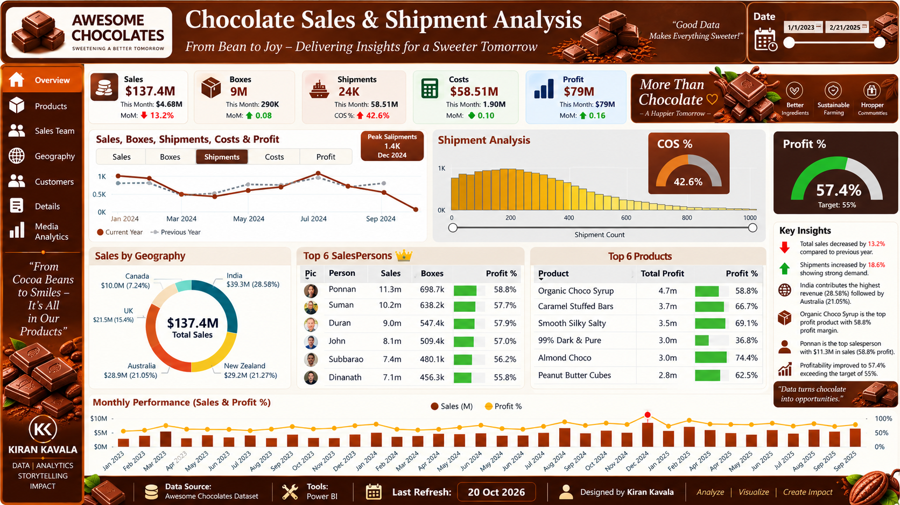
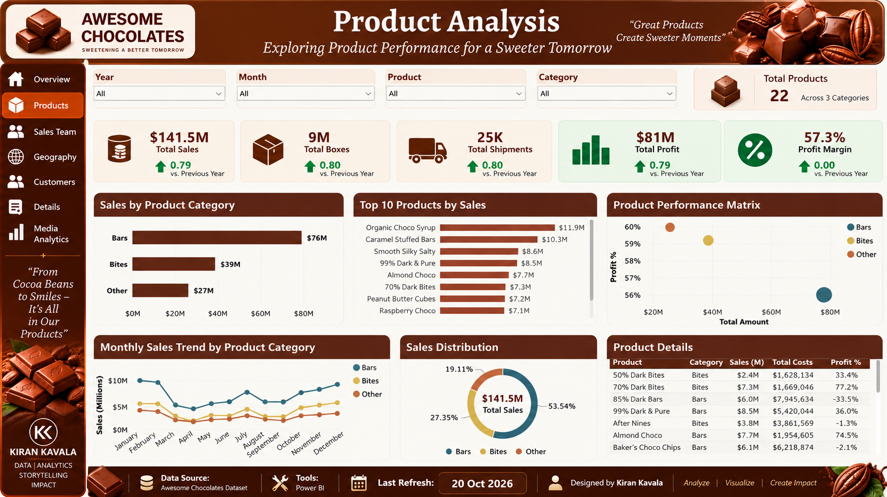
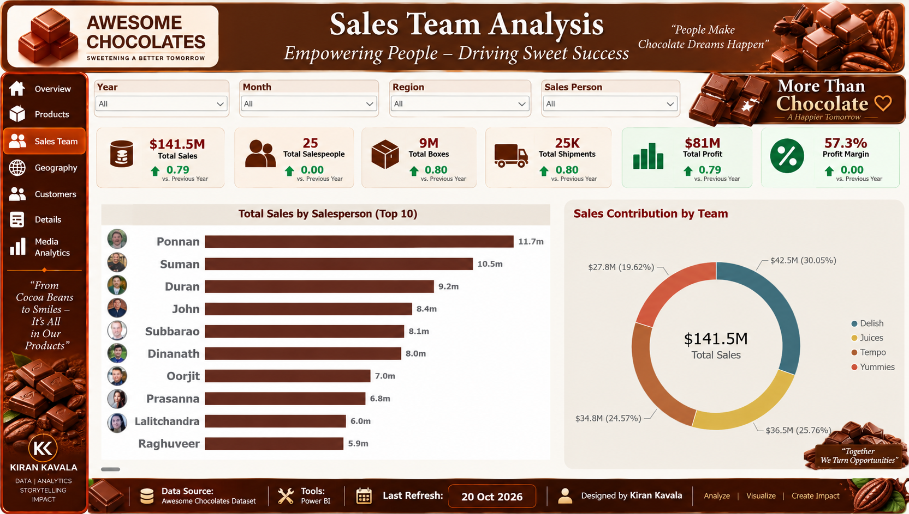
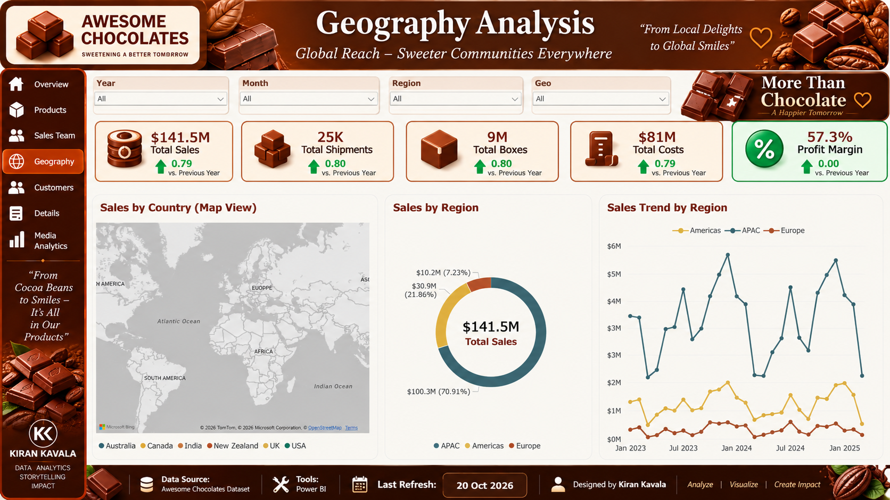
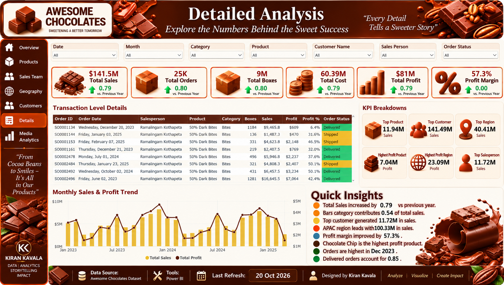

# 🍫 Chocolate Sales & Shipment Analysis — Power BI

An interactive **Power BI Business Intelligence dashboard** designed to analyze chocolate sales, shipments, products, sales team performance, geography, customers, and media analytics.

This project transforms business data into an interactive analytical report that helps users explore performance through KPIs, trends, comparisons, and detailed transaction-level analysis.

---

# 🚀 Project Access

## 🌐 Interactive Power BI Dashboard

👉 [Open Interactive Power BI Report]([https://app.powerbi.com/reportEmbed?reportId=6159141b-68ca-4a8d-a481-3df4b5309fb9](https://app.powerbi.com/links/h_XqwBcsTJ?ctid=56c1d497-700b-49cf-8f8d-3dd6b20d522f&pbi_source=linkShare&bookmarkGuid=9c213744-b202-4815-80ff-92b50b52d3c7))

> The interactive Power BI report may require Power BI access or sign-in.

## 📥 Download Power BI Project

The complete Power BI `.pbix` file is available through the following links:

### 📦 GitHub Release

👉 [Download from GitHub Release](https://github.com/Kirankavala143/Chocolate-Sales-Analysis-PowerBI/releases/tag/v1.0.0)

### ☁️ Google Drive

👉 [Download Power BI PBIX File](https://drive.google.com/file/d/1xec5INw9Oe9dVOTE84L6QihG1Z9eunaz/view?usp=sharing)

[Additional Google Drive Project Link](https://drive.google.com/file/d/1tt4T89G_N2t4zAJNXSnjtq0gjOuePspO/view?usp=sharing)

> The `.pbix` file requires Microsoft Power BI Desktop to open. Confirm that the shared links have the correct access permissions.

---

# 📊 Dashboard Overview

The repository includes **7 dashboard pages**.

## 🏠 1. Overview

Provides an executive-level summary of business performance, including:

- Total Sales, Boxes, Shipments, Costs, and Profit
- Profitability trends
- Sales by Geography
- Salesperson performance
- Monthly performance

## 🍫 2. Products Analysis

Analyzes product-level performance, including:

- Product sales and profitability
- Product categories
- Top-performing products
- Product performance trends
- Sales distribution

## 👥 3. Sales Team Analysis

Analyzes salesperson performance through:

- Sales by salesperson
- Sales contribution
- Individual performance
- Salesperson comparisons
- Performance trends

## 🌍 4. Geography Analysis

Provides geographical analysis through:

- Sales by country and region
- Geographic distribution
- Regional sales trends
- Interactive map visualization

## 👤 5. Customers Analysis

Analyzes customer and order performance through:

- Total customers and orders
- Customer sales and average spending
- Repeat customer rate
- Order status distribution
- Shipment trends
- Regional profitability
- Customer-level details

## 🔎 6. Detailed Analysis

Provides transaction-level analysis through:

- Order ID and Order Date
- Salesperson, Product, and Category
- Boxes, Sales, Profit, and Profit %
- Order Status
- Monthly Sales & Profit Trend
- KPI Breakdowns and Quick Insights

## 📱 7. Media Analytics

The Media Analytics page analyzes digital campaign performance across social media platforms using the `Campaign Data` and `Platform Summary` tables.

### Campaign Data
- Campaign name, campaign type, date, platform, and creative name
- Impressions and reach
- Clicks, likes, comments, shares, and saves
- Video views and advertising spend

### Platform Summary
- Platform-level impressions, reach, clicks, and engagements
- Click-Through Rate (CTR) and engagement rate
- Views and conversions
- Cost per conversion and advertising spend

### Dashboard Visualizations
- **KPI Cards:** Total Impressions, Total Reach, Total Engagements, Average CTR, and Total Conversions
- **Engagement Distribution:** Engagement comparison across platforms
- **Views Trend by Month:** Monthly views performance
- **Conversions by Platform:** Platform-level conversion comparison
- **Campaign Performance Trend:** Campaign performance over time
- **Top-Performing Ad Creatives:** Comparison of creative performance using impressions, clicks, CTR, conversions, and spend

This page helps analyze audience engagement, compare social media platforms, track campaign performance, and evaluate advertising effectiveness.

# 🖥️ Dashboard Preview

## 🏠 Overview



---

## 🍫 Products Analysis



---

## 👥 Sales Team Analysis



---

## 🌍 Geography Analysis



---

## 👤 Customers Analysis


---

## 🔎 Detailed Analysis



---

## 📱 Media Analytics


---

# 📈 Key Performance Indicators

The main sales dashboard highlights the following business metrics:

| Metric | Value |
|---|---:|
| Total Sales | $137.4M |
| Boxes Sold | 9M |
| Total Shipments | 24K |
| Total Costs | $58.51M |
| Total Profit | $79M |
| Profit Margin | 57.4% |

*These figures reflect the original project summary. Values displayed on individual pages may differ depending on the metrics, filters, or report version.*

Media Analytics includes additional campaign metrics such as impressions, reach, engagement, CTR, views, and conversions.

---

# 🛠️ Tools & Technologies

- **Microsoft Power BI Desktop**
- **DAX**
- **Power Query**
- **Data Modeling**
- **Data Transformation**
- **Business Intelligence**
- **Data Visualization**
- **Interactive Dashboard Design**

---

# 🧠 Skills Demonstrated

- Data cleaning and transformation
- Data modeling and DAX measure creation
- KPI development and reporting
- Sales and profitability analysis
- Product and customer analysis
- Sales team performance analysis
- Geographic and regional analysis
- Transaction-level analysis
- Trend analysis and business insights
- Media and campaign performance analysis
- Interactive dashboard development
- Data visualization and business storytelling
- Dashboard UI/UX design

---

# 🔍 Business Analysis Areas

## Product Performance

Explore product-level sales, category performance, and profitability to understand which products contribute to business results.

## Sales Team Performance

Compare salesperson sales contributions and individual performance.

## Geographic Performance

Explore sales across countries and regions using map visualizations and regional trends.

## Customer Performance

Analyze customer activity, orders, spending, shipment behavior, and order status.

## Transaction-Level Analysis

Inspect individual transactions while comparing monthly sales and profit performance.

## Media Campaign Performance

Explore impressions, reach, engagement, CTR, conversions, platform performance, and advertising creative results.

---

# 📊 Dashboard Design

The dashboard uses a consistent chocolate-inspired visual theme across its pages.

Design elements include:

- Custom dashboard headers
- Navigation sidebar
- KPI cards
- Interactive charts and tables
- Geographic maps
- Trend analysis
- Conditional formatting
- Consistent typography and color palette
- Page-to-page navigation

---

# 🎯 Project Objective

The objective was to transform business data into interactive Power BI dashboards that help users understand:

**Sales → Products → Sales Team → Geography → Customers → Profitability**

The Media Analytics page extends the analysis to digital campaign performance and platform-level metrics.

The project focuses on turning data into meaningful insights through data modeling, DAX calculations, interactive visualizations, and dashboard design.

---

# 💡 Key Takeaways

The dashboards provide a visual way to explore business performance, including:

- Where sales are generated
- Which products contribute to sales and profit
- How salespeople and regions perform
- How customers interact with the business
- How sales and profit change over time
- Which media platforms and campaigns generate engagement and conversions
- Detailed transaction and campaign performance

---

# 🚀 Project Highlights

- 7 dashboard pages documented
- Interactive Power BI report
- Custom chocolate-inspired dashboard design
- KPI-driven business analysis
- Product-level analysis
- Salesperson analysis
- Geographic analysis
- Customer analysis
- Transaction-level analysis
- Media analytics
- Sales and profitability analysis
- Trend analysis and interactive visual storytelling

---

# 📂 Project Structure

```text
Chocolate-Sales-Analysis-PowerBI/
│
├── screenshots/
│   ├── Overview.png
│   ├── Products.png
│   ├── Sales-Team.png
│   ├── Geography.png
│   ├── Customers Analysis.png
│   ├── Details.png
│   ├── Media Analytics.png
│   └── README.md
│
└── README.md
```

---

# 👨‍💻 Author

## Kiran Kavala

**B.Tech — Computer Science Engineering (AI & ML)**

Interested in building practical solutions using:

- Data Analytics
- Business Intelligence
- Artificial Intelligence
- Machine Learning
- Software Development

### 🔗 Connect with me

- **LinkedIn:** [Kiran Kavala](https://www.linkedin.com/in/kiran-kavala)
- **GitHub:** [Kirankavala143](https://github.com/Kirankavala143)
- **Portfolio:** [Visit My Portfolio](https://kiran-portfolio-fawn.vercel.app)

---

# ⭐ Project

If you find this project interesting, feel free to explore the repository, review the dashboard screenshots, and share your feedback.

---

### 📌 Note

This repository contains project documentation and dashboard screenshots. Use the linked Power BI report or PBIX download to explore the report interactively.
